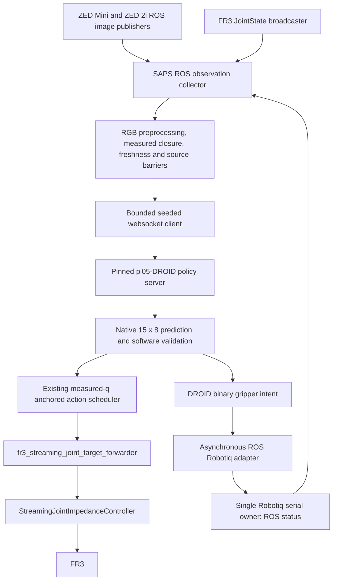

# C4 physical FR3 integration

Current package migration (2026-11-10): source the existing ROS workspace and
`~/franka_ehsan_ros2_ws/install-droid-current/setup.bash` before these workflows.
The independent repository is `~/franka_ehsan_ros2_ws/src/franka_droid_stack`;
pass that Git root as `--lab-stack-dir`. The ROS package/module names are now
`franka_droid_stack` / `franka_droid_stack_runtime`. Robotiq hardware commands
use `python -m franka_robotiq.robotiq_node`; the Make target names and existing
C4 local JSON are retained. The policy-specific adapter remains in SAPS.
The controller plugin and message types keep their original identifiers.
Historical pins/evidence below remain historical; strict source qualification
is not refreshed by this migration. See the independent repository's README
and `franka_robotiq/README.md` for build, interfaces and supervised commands.


**Current execution instructions:** use the
[bounded development workflow](physical_development_rollout.md). The redundant
Robotiq-profile geometry veto has been removed from joint-space execution;
operator `--execute` and the existing runtime protections remain. Earlier
NO-GO/guard statements below describe the historical audit, not a current
software approval requirement. Hardware findings are still unverified.

The current [development rollout workflow](physical_development_rollout.md)
separates recorded dirty-source development from strict experiment qualification.
Clean Git trees and exact lab manifests are no longer development execution
prerequisites. Physical guards remain independent and blocking where protection
or controller/load configuration has not been established.

The [2026-11-09 joint-space geometry audit](physical_joint_space_geometry_audit.md)
refines the earlier TCP blocker: autonomous action interpretation and the flange
singularity gate do not require a Robotiq fingertip TCP. Controller frame/load
review, collision/clearance/workspace safety and provenance remain mandatory;
physical execution is still blocked. That audit gives the current conditional
command with the existing Makefile singularity threshold made explicit.

C4 adds an explicit ZED Mini / ZED 2i / Robotiq profile and a finite, non-actuating
observation/readiness/shadow entry point. It reuses the existing policy client,
observation collector, deterministic preprocessing, warm-up, source barriers and
arm/gripper execution adapters. It does not add a robot-control route.

**Physical execution remains NO-GO.** The required measured tool geometry,
libfranka end-effector/payload configuration, collision/workspace verification,
reviewed source pin and operator safety evidence are not established. A JSON
`execution_ready=true` cannot bypass `require_supported_arm_geometry()`.
No physical camera/gripper/controller test, live policy inference or rollout was
performed by Codex during C4 implementation. Offline fixtures do not approve motion.

The subsequent [single-chunk execution audit](physical_c4_execution_audit.md)
checks the researcher's saved C4 shadow result against the generated arm model,
lists the measurements still needed without CAD, and provides the conditional
one-chunk command. Physical execution remains blocked.

## Repository/runtime audit

| Repository | Inspected HEAD / branch | Role and decision |
|---|---|---|
| `saps-openpi-replication` | `ee29c2c7d931a44ea1878c44c27228ac2f752c1d`, `implement/physical-zed-robotiq` | Owns the ROS physical rollout, seeded policy client, action mapping and new C4 non-actuating entry point. One worktree; existing changes preserved. |
| Unified `src/fr3_lab_stack` | `4bb6cdc58839dcdd94acbe1633b8f361676a4eb6`, `implement/zed-robotiq` | Owns the unchanged streaming controller/forwarder and C3 camera interface. One worktree; source unchanged by C4. |
| `franka-fr3-robot-learning` | `011c2807ea115fd32d7c042038c5f54b33a810b0`, `experiment/hvl-fr3-pi05-deployment` | Separate native/franky streaming and fine-tuned checkpoint workflow. One worktree, substantial existing changes; inspected, not modified or launched. |

Available SAPS branches are `main`, `experiment/physical-fr3-saps`, and
`implement/physical-zed-robotiq`. The current dirty implementation branch was
retained; no checkout, reset, migration, commit or push was performed.
Source inspection establishes ownership of the intended ROS pipeline, **not**
the identity of an already-running server. The live metadata handshake decides
that before any inference request.

The alternate repository's `Server Run.txt` starts
`/openpi_assets/pi05-fr3-v3-12000`, a fine-tuned checkpoint. The existing SAPS
contract instead pins `gs://openpi-assets/checkpoints/pi05_droid`. C4 preserves
that pin and rejects the fine-tuned identity; it does not silently treat the
same `pi05_droid` model-config name as the same checkpoint. Selecting the
fine-tuned checkpoint requires explicit identity review and a separate approved
profile/protocol change. Never run the other repository's native streamer
concurrently with ROS effort control.

## Execution sequence and retained boundaries



The **execution** branch is the existing `scripts/physical_policy_execution.py`
→ `live_inference_hold_ros.run_inference_hold(policy_execution=True)` →
`policy_execution.run_policy_episode`. `StreamingBoundary` receives measured
robot/Franka/controller evidence and publishes only to
`/fr3_streaming_joint_target`. The forwarder validates targets and republishes
unchanged to `/fr3_streaming_joint_impedance_controller/target_joint`. Its active
controller poll, expiry and target-age checks remain unchanged. No policy code
publishes directly to the controller target topic.

Each replan retains the existing confirmed measured-q pre-hold, inference under
hold, validation, first **8** native actions at **15 Hz**, terminal measured-q
hold and delivery/health audits. Each action uses fresh measured q:

```text
q_target[k] = q_measured[k] + 0.2 * clip(action[k, 0:7], -1, 1)
```

Targets never accumulate. Exactly `[15,8]` finite predictions qualify; the
unused future predictions remain archived. The existing scheduling, joint
margin, state/action ages, singularity gate, stop-on-failure, evidence joins,
finite chunk limits and no-catch-up behavior remain unchanged. Terminal arm
holds and gripper cleanup belong to the existing ROS execution lifecycle;
C4 diagnostics construct neither a `StreamingBoundary` nor a command adapter.

## Interface comparison and assumption classification

| Interface | Historical configuration | C4 configuration / classification |
|---|---|---|
| Wrist | RealSense D435i / serial `342222073510` | Mini `zedm` / `15330503`, `/wrist_camera/zed_node/rgb/color/rect/image`; required new profile |
| External | RealSense D435i / serial `244222076317` | ZED 2i `zed2i` / `32919961`, `/external_camera/zed_node/rgb/color/rect/image`; required new profile |
| Native image | 1280×720 RGB8 | 1280×720 BGRA8, alpha removed and BGR channels reordered; decoder already adapted |
| Client preprocessing | Centre 16:9 crop, resize to RGB HWC `[180,320,3]` uint8 | Same deterministic code; no mirror, rotation, stretching or new undistortion |
| Camera acquisition | RealSense launch and BEST_EFFORT subscriptions | Existing C3 RGB-only HD720/30 launcher, SDK SYSTEM_CLOCK stamps, RELIABLE cameras depth 2 |
| Camera selection | Latest images, both timestamps advance | Retained; C3 closest-buffer matching is **not** substituted |
| State QoS | Sensor-data BEST_EFFORT | Retained independently of camera QoS |
| Hand feedback | Franka finger JointStates, maximum 0.04 m per finger | Existing JSON ROS status from Robotiq; measured actual motor register and verified two-point closure |
| Gripper transport | Franka Move/Grasp/Stop | Existing single serial server and async OPEN/CLOSE/STOP ROS services; no second serial owner |
| Arm/controller/forwarder | Lab streaming impedance path | Unchanged; physical use still blocked |
| Policy | Pretrained pi05-DROID, OpenPI `15a9616a00943ada6c20a0f158e3adb39df2ccac` | Same identity, protocol and scale |
| TCP/payload | Franka Hand TCP/FK/collision assumptions | Unresolved tool replacement; mandatory execution block |

Required modifications were the C4 identities/topic/model contract, camera QoS,
unified-workspace environment selection, bounded capture/shadow workflow and
readiness/logging. BGRA/padded-row decoding, normalized measured closure and
async command transport were already adapted and are reused. Historical
`physical_pi05_fr3.json`, `physical_pi05_fr3_zed_robotiq.json`, RealSense launch,
G1B exact pin and experiment outputs remain unchanged. Old paths in historical
M3/G1B runbooks and frozen artifacts are historical, not broadly replaced.
SpaceMouse's separate MoveIt/Franka-Hand model assumptions and the alternate
native streamer are unrelated to this adapter and were not changed.

## Verified policy image/state contract

The authoritative source is the pinned OpenPI submodule, not a new assumption:
`training/config.py` config `pi05_droid` has a 15-step horizon;
`policies/droid_policy.py` accepts these raw RLDS keys and maps exterior to
`base_0_rgb` and wrist to `left_wrist_0_rgb`, masking the unused right-wrist image.

```text
observation/exterior_image_1_left: [180,320,3], RGB uint8 HWC
observation/wrist_image_left:     [180,320,3], RGB uint8 HWC
observation/joint_position:       [7], float32 radians in FR3 canonical order
observation/gripper_position:     [1], float32 normalized measured closure
prompt:                          explicit nonempty string
```

The websocket client does not resize/normalize those images. The physical
adapter performs its historical centre crop and OpenCV INTER_AREA downsize
(INTER_LINEAR upsize). `decode_ros_rgb_image` respects padded `step`, removes
alpha and maps BGRA8 to RGB. Unsupported encodings, malformed lengths/strides
and unexpected native profiles reject the observation. OpenPI's server-side
model transforms perform the 224×224 padded resize and checkpoint normalization;
model inputs convert image uint8 to floating `[-1,1]`. State/action normalization
uses the unchanged checkpoint assets. No training/checkpoint/model code changed.

C4 captures per-role native decoded RGB and exact policy RGB as PNG plus the
existing NPZ payloads, including timestamp/frame/encoding evidence and measured
preprocessing latency. Native PNG means decoded RGB at native resolution, not
an unchanged BGRA byte dump. A researcher must confirm orientation, roles,
scene/workspace/gripper visibility and training-view compatibility. Dimensions
and successful inference alone cannot prove visual/training compatibility.

## Temporal integration decision

The accepted camera-only C3 RELIABLE result is reported by the researcher as
898/900 pairs (99.78%), about 29.95 received FPS, p99 skew about 12.51 ms and p99
ages about 79.93/67.73 ms, with seven engineering criteria satisfied. This is not
an inference-load/motion result. All C3 reports are preserved.

C4 deliberately retains latest-frame sampling and the historical **500 ms age /
250 ms all-source skew** limits. It uses RELIABLE KEEP_LAST depth 2 only for
cameras; joint/status subscriptions retain compatible sensor-data QoS. Both
camera source stamps must advance between committed requests. Missing,
malformed, stale, future-dated, owner-changing or faulted sources prevent a
request. The existing four-source barrier after discarded warm-up requires new
camera, joint and gripper source stamps; late delivery of pre-barrier messages
cannot qualify. There is no silent transfer of C3's 33/100 ms pairing thresholds,
no synthetic 15 Hz image publication and no replanning/cadence redesign.

The C4 shadow loop first validates full hardware observation/readiness, then
runs exactly one discarded warm-up with seed 20260917. After all sources cross
its response barrier, main seed 20260827 uses indices 0,1,... with model-input
audit at main index 0. Main requests remain finite (1–100). Images are saved
without adding PNG work before policy submission. Raw `[15,8]` responses,
request timing, audit evidence and predicted OPEN/CLOSE decisions are retained.
Preview joint targets, when a deployed URDF is supplied, use the existing
`candidate_target` position check anchored to the **observation snapshot**, not
a future measured execution reference. They are always `safe_to_execute=false`;
geometry, streaming health, collision, velocity/acceleration and physical grasp
checks are not certified by this preview. Out-of-range coordinates are logged,
not silently rescaled; actual execution retains its existing clipping/gates.

## Robotiq state, commands and ownership

The existing server owns one exclusive `/dev/serial/by-id/...` port at configured
slave/baud. C4 never instantiates `RobotiqRtu` in the observation/client process.
Status now includes server-instance UUID, PID, exclusive-owner and authorization
flags, command generation/busy state, read latency, plus measured position,
requested position, activation/fault/contact and timestamps. Unique ROS publisher
and node binding are checked; changed ownership is latched as a readiness failure.
Adapter/ROS identity is not an electronic serial-number proof of the gripper
model itself. Confirm wiring/model physically. Exclusive access prevents another
cooperating serial owner; it is not proof against arbitrary external software.

Policy feedback uses **actual_position**, never requested position:

```text
raw_closure = (actual_position - open_position)/(closed_position - open_position)
closure = clip(raw_closure, 0, 1)           # 0 OPEN, 1 CLOSED
estimated_width = maximum_width_m * (1 - closure)
```

The local operator config contains verified endpoint evidence (3 open, 227
selected empty-close, observed repeat variation to 228). Its width evidence
mentions approximate finger dimensions and a **nominal 85 mm reference**, not
an independently validated usable-width measurement. C4 copies it unchanged;
it does not auto-approve calibration or turn nominal width into a direct
fingertip sensor. Policy closure is a register-derived estimate. Accurate usable
opening, contact-dependent geometry and calibration uncertainty remain review
requirements. Missing/unverified endpoints/evidence reject observation readiness.

`action[7] > 0.5` means CLOSE; `<=0.5` means OPEN. Existing targets are configured
0/255, speed 64 and force 32 (register units, not m/s/Newtons); local settings are
copied verbatim. The existing default command timeout is 3 seconds. Commands
are nonblocking in the policy process, duplicate intent is suppressed while its
owned transition remains queued/issued/completed, and reversal waits for STOP
acknowledgement and the prior command result. Unexpected external cancellation
now latches failure and stops; it cannot become a suppressed repeated command.
Writes/acknowledgements, completion, measured contact and before/after evidence
remain distinct. CLOSE/contact never sets automatic grasp/task success.

Readiness requires fresh healthy activated feedback, verified endpoint
calibration, expected adapter/slave/settings, exactly one server, and (for
execution readiness) explicitly authorized OPEN/CLOSE/STOP services and no busy
manual command. Merely running a process does not authorize movement. Activation
and reset remain separate explicit commands; no diagnostic automatically calls
them. Failures latch and stop boundedly; there are no automatic OPEN commands,
activation retries or emergency auto-release. Server Ctrl+C preserves the existing
STOP semantics and closes serial. A read-only server sends no output writes.

## Geometry, model and safety NO-GO evidence

No verified Robotiq mounting/TCP/collision/payload artifact was found in the
inspected workspace or task-specific calibration/configuration paths. Saved
named joint poses in the current xacro are not a mounting calibration. An
unreviewed CAD/STEP assembly is not an approved robot model.

Required follow-up artifacts and checks:

1. Measured flange (`fr3_link8`) → bracket → tool/TCP transforms, units, axis/
   quaternion convention, physical fiducials/reference points and measurement
   uncertainty; reconcile them with the actual SDK `F_T_EE`/stiffness frame.
2. Mass, centre of mass and inertia/payload evidence for gripper, bracket,
   camera/mount and attached items; reviewed robot-native load settings.
3. Correct URDF/SRDF conservative collision geometry and all gripper-opening
   envelopes; verified mounting orientation and a TF tree with one authority.
4. Workspace/table/self-collision clearances with measured uncertainty and
   evidence that the chosen independent supervision is active. Displaying a
   collision mesh in RViz is not collision enforcement in torque streaming.
5. Measured usable opening/calibration provenance and contact limitations.
6. Offline and supervised verification of TCP FK/Jacobian/frame-dependent
   workspace and payload assumptions with the actual deployed robot model.
7. Operator-confirmed native safety/reflex settings, E-stop, command ownership,
   controller transition, finite budget and shutdown behavior.

The seven-joint limits/target mapping remain arm-joint quantities. The policy
singularity diagnostic shifts the historical TCP Jacobian back to the flange.
However, `fr3_forward_kinematics`/`fr3_kinematics` still describe the Franka TCP,
and the **hybrid impedance controller uses libfranka's end-effector Jacobian**.
Correct SDK tool frames and payload therefore matter even though its law is
unchanged. No controller or safety gate was altered.

Both repositories are dirty. The exact-clean historical G1B pin is unchanged.
The current C3 lab tree differs from `zed_robotiq_lab_sources.json`; C4 records
added/changed/missing paths and manifest hash without regenerating that pin.
Reviewed clean commits and a reviewed matching source manifest are required
before execution. Do not use a config flag, disable a version check, or blindly
regenerate a manifest to silence these blockers. The current geometry guard
remains unconditional for this hardware until a reviewed geometry integration
actually implements the measured model.

## Terminal-by-terminal researcher workflow

Commands below are prepared, **not executed against hardware by Codex**. Use
fresh run identifiers. Current authorized next stages are profile preparation,
observation capture and strictly non-actuating shadow inference. Physical
controller transition/rollout stages remain blocked until the requirements
above are resolved and the geometry implementation is reviewed.

### Environment and local profile preparation

In the SAPS repository:

```bash
cd ~/saps-openpi-replication
source tools/activate_physical_env.sh
# Creates a NEW local file. Does not open serial, activate anything, or overwrite
# the existing commissioning configuration/calibration.
"$PHYSICAL_PYTHON" tools/prepare_c4_config.py \
  --hardware-config configs/local/zed_robotiq.json \
  --output configs/local/c4_zed_robotiq.json
export PHYSICAL_CONFIG="$PWD/configs/local/c4_zed_robotiq.json"
export C4_CONFIG="$PHYSICAL_CONFIG"
export PHYSICAL_PROMPT='YOUR_EXPLICIT_TASK'
```

`activate_physical_env.sh` sources Jazzy and the unified workspace, activates
`.venv-physical`, exports the unified workspace/install/description/control paths
for Make, and disables user-site Python packages. This prevents user-installed
NumPy 2.x from overriding the system NumPy/OpenCV ABI. It does not install or
modify dependencies. Re-export `PHYSICAL_CONFIG` after sourcing in each new
terminal: its historical default still points at the original local file.
Do not edit the older configuration to make it appear to be the C4 baseline.

Review the new JSON before use. Its camera identities/topic/model/version fields
come from the explicit C4 template. Adapter path, slave, baud, register targets,
speed/force/timeouts and calibration are copied verbatim from the supplied local
gripper config. Missing or unverified settings remain missing/unverified. The
geometry block remains false regardless of local booleans.

### Terminal 1 — FR3 state/hardware bringup

For observation-only work, reuse the independently commissioned FR3 state
publisher/driver if already running, with the operator keeping the robot
stationary. Do not start a second driver or a native streamer. Read-only checks:

```bash
source /opt/ros/jazzy/setup.bash
source ~/franka_ehsan_ros2_ws/install/setup.bash
ros2 control list_controllers --controller-manager /controller_manager
ros2 topic info -v /franka/joint_states
```

For a later approved cold bringup, the inspected unified `franka_bringup` launch
supports this root-namespace command (substitute the operator-verified robot IP
if it differs). It does not start a Franka Hand server:

```bash
# FUTURE OPERATOR STAGE: retain geometry/safety NO-GO until resolved.
ros2 launch franka_bringup franka.launch.py \
  arm_id:=fr3 robot_ip:=192.170.10.101 load_gripper:=false \
  use_fake_hardware:=false
```

Root namespace yields `/controller_manager`, `/robot_state_publisher` and the
configured `/franka/joint_states` broadcaster source. An alternative namespace
requires a separately checked profile/forwarder contract; do not silently remap.
Starting this driver is not approval of the Robotiq collision/payload model.

### Terminal 2 — Existing impedance controller (blocked future stage)

After geometry/load/native safety review, stop SpaceMouse publishers/Servo and
any competing policy/native streamer. Inspect active controllers first. Load
and configure the existing plugin, initially inactive:

```bash
source /opt/ros/jazzy/setup.bash
source ~/franka_ehsan_ros2_ws/install/setup.bash
ros2 control list_controllers --controller-manager /controller_manager
ros2 run controller_manager spawner fr3_streaming_joint_impedance_controller \
  --controller-manager /controller_manager --inactive \
  --param-file "$HOME/franka_ehsan_ros2_ws/src/fr3_lab_stack/config/streaming_joint_impedance_controller.yaml"
```

If the historical `fr3_arm_controller` is the active competing controller, the
operator-reviewed transition is:

```bash
ros2 control switch_controllers --controller-manager /controller_manager --strict \
  --deactivate fr3_arm_controller --activate fr3_streaming_joint_impedance_controller
```

If there is no competing commanding controller, activate the configured plugin:

```bash
ros2 control set_controller_state fr3_streaming_joint_impedance_controller active \
  --controller-manager /controller_manager
ros2 control list_controllers --controller-manager /controller_manager
```

Choose the branch from actual controller evidence, not by trial/retry. Unknown
active controllers or failed switching are NO-GO. Do not activate an example
periodic-motion controller. The existing streaming controller anchors its hold
to measured q on activation; that mechanism still needs supervised verification
with the actual SDK end-effector/load configuration.

### Terminal 3 — Existing streaming forwarder (blocked execution stage)

Use the one existing process if already running:

```bash
source /opt/ros/jazzy/setup.bash
source ~/franka_ehsan_ros2_ws/install/setup.bash
ros2 run franka_droid_stack fr3_streaming_joint_target_forwarder --ros-args \
  --params-file "$HOME/franka_ehsan_ros2_ws/src/fr3_lab_stack/config/streaming_joint_target_forwarder.yaml"
```

Read-only verification from another configured terminal:

```bash
ros2 topic info -v /fr3_streaming_joint_target
ros2 topic info -v /fr3_streaming_joint_target_forwarder/telemetry
ros2 topic info -v /fr3_streaming_joint_impedance_controller/state
```

There must be exactly one forwarder subscriber for the policy target topic.
Graph existence is not fresh runtime health/T4 evidence: existing execution
checks still require controller activity, native Franka health, ready evidence,
unique target application and timing joins. Do not publish manual targets to
"test" this as part of observation/shadow stages.

### Terminal 4 — ZED cameras

Reuse the accepted C3 owner, or launch once if absent:

```bash
source /opt/ros/jazzy/setup.bash
source ~/franka_ehsan_ros2_ws/install/setup.bash
ros2 launch franka_zed_cameras dual_zed.launch.py \
  wrist_serial:=15330503 exterior_serial:=32919961 exterior_model:=zed2i \
  wrapper_version:=5.5.0 resolution:=HD720 fps:=30
```

The C4 camera check reuses `fr3_lab_stack_runtime.camera_validation.inspect_sources`:
unique node/topic binding, configured serial/model/profile, SYSTEM_CLOCK convention,
software versions and the audited wrapper-5.5.0 depth-NONE tracking omission
rule all remain mandatory. It does not read an image label as device identity.
No vendor code or acquisition settings changed.

### Terminal 5 — One Robotiq server

Stop the older server cleanly before restarting the updated code so that C4
gets owner-instance/PID metadata. Do not run standalone serial status/observation
commands concurrently with a server. For observation and shadow stages:

```bash
cd ~/saps-openpi-replication
source tools/activate_physical_env.sh
export PHYSICAL_CONFIG="$PWD/configs/local/c4_zed_robotiq.json"
"$PHYSICAL_PYTHON" -m franka_robotiq.robotiq_node \
  --config "$PHYSICAL_CONFIG" --mode serve
```

This publishes raw feedback only, with no output-register writes and no command
services. It does not activate a deactivated gripper. If activation is missing,
stop here, stop the serial-owning server, and use the existing separately
supervised activation procedure. Afterward restart the one server. No policy
process owns serial.

Only at a later explicitly authorized command-readiness/physical stage, stop
that read-only server and start the same implementation with authorization:

```bash
"$PHYSICAL_PYTHON" -m franka_robotiq.robotiq_node \
  --config "$PHYSICAL_CONFIG" --mode serve --authorize-gripper
```

Authorization exposes OPEN/CLOSE/STOP; it does not activate/reset or command
finger motion on initialization. Service endpoints are `/robotiq/open`,
`/robotiq/close`, `/robotiq/stop`; measured status is `/robotiq/status`.

### Terminal 6 — Correct policy server

Resolve the checkpoint discrepancy described above before choosing a server.
Do not start another process on an occupied port or replace a running server
implicitly. The preserved SAPS pretrained identity is launched with:

```bash
cd ~/saps-openpi-replication
make droid-policy-server
```

This is a separate explicit researcher action; it may load/download the existing
checkpoint and use the GPU. Do not use the fine-tuned compose override from the
other repository. C4 expects localhost:8000, seeded protocol/model audit metadata,
OpenPI `15a9616a...`, native horizon 15 and the exact pretrained checkpoint string.
A different identity fails before a request. No inference server/checkpoint code
or sampling settings were changed by this integration.

### Terminal 7 — Observation-only capture, then shadow

With existing stationary FR3 state, both cameras and the read-only gripper server:

```bash
cd ~/saps-openpi-replication
source tools/activate_physical_env.sh
export PHYSICAL_CONFIG="$PWD/configs/local/c4_zed_robotiq.json"
export PHYSICAL_PROMPT='YOUR_EXPLICIT_TASK'
make physical-c4-observations C4_CONFIG="$PHYSICAL_CONFIG" C4_SAMPLES=3 \
  PHYSICAL_RUN_ID=c4_observations_UNIQUE_ID PHYSICAL_PROMPT="$PHYSICAL_PROMPT"
```

No controller or policy server is contacted by this mode. Inspect:

```text
outputs/physical_c4/c4_observations_UNIQUE_ID/run.json
outputs/physical_c4/c4_observations_UNIQUE_ID/observations/request_0000/
  observation.npz
  native_rgb.npz
  request.json
  wrist_native_decoded_rgb.png       external_native_decoded_rgb.png
  wrist_policy_rgb.png               external_policy_rgb.png
  image_evidence.json
```

Visually approve roles/orientation/viewpoint in a research log; software never
marks visual compatibility approved automatically. Recheck raw/normalized grip
state, age/skew, schema and preprocessing latency before inference.

Once the correct policy server is ready, run the bounded warmed shadow workflow:

```bash
make physical-c4-shadow C4_CONFIG="$PHYSICAL_CONFIG" C4_SAMPLES=1 \
  PHYSICAL_RUN_ID=c4_shadow_UNIQUE_ID PHYSICAL_PROMPT="$PHYSICAL_PROMPT"
```

This sends one discarded warm-up and one main request, executes zero predicted
arm/gripper actions, and creates `shadow/warmup/request_0000/` plus
`shadow/request_0000/` under the new run directory. Main artifacts include raw
`actions.npz`, `response.json`, request timing, model audit, per-role images and
`predicted_commands.json`. All 15 predictions are retained; rows mark the
existing eight-action execution window. Investigate early CLOSE/oscillation,
large clipped coordinates and joint-specific behavior from these raw artifacts.
Do not change the prompt or threshold to disguise unusual predictions.

Optional read-only deployed-model snapshot/position-feasibility preview:

```bash
# Capture once into a NEW file; do not overwrite earlier model evidence.
ros2 param get --hide-type /robot_state_publisher robot_description > /tmp/c4_robot_description_UNIQUE_ID.urdf
"$PHYSICAL_PYTHON" scripts/physical_c4.py --mode shadow \
  --config "$PHYSICAL_CONFIG" --samples 1 --prompt "$PHYSICAL_PROMPT" \
  --robot-description /tmp/c4_robot_description_UNIQUE_ID.urdf \
  --output-dir outputs/physical_c4/c4_shadow_with_model_UNIQUE_ID
```

A supplied URDF enables snapshot joint-position feasibility reporting only; it
is not automatic approval of the tool model or any trajectory.

### Terminal 8 — Readiness and bounded physical execution (NO-GO today)

With a later authorized single gripper server, controller/forwarder and policy
server, this **non-actuating** readiness command checks complete observations,
command service availability, active controller/unique forwarder graph and
policy handshake. It still reports `physical_rollout_readiness=NO-GO` for the
unresolved geometry/source/safety gates:

```bash
make physical-c4-readiness C4_CONFIG="$PHYSICAL_CONFIG" C4_SAMPLES=1 \
  PHYSICAL_RUN_ID=c4_readiness_UNIQUE_ID PHYSICAL_PROMPT="$PHYSICAL_PROMPT"
```

Exit 0 means the selected non-actuating checks passed, **not** permission to move.
Fresh streaming health/application evidence and independent safety supervision
are subsequently required by the existing execution path and operator procedure.

Only after measured geometry is actually integrated/reviewed, the source pin
matches reviewed clean commits, all readiness/visual/shadow gates pass, and the
operator explicitly authorizes a supervised run, the smallest existing budget
is one chunk: **8 policy actions at 15 Hz**, nominal 0.533333333 s through the
terminal-hold deadline, plus existing pre-holds/warm-up/inference/waits. Total
wall time includes separately bounded observation/policy/application timeouts.
The command below is a future template and is deliberately rejected today:

```bash
"$PHYSICAL_PYTHON" scripts/physical_policy_execution.py --execute --enable-gripper \
  --config "$PHYSICAL_CONFIG" --prompt "$PHYSICAL_PROMPT" \
  --max-replans 1 --max-executed-policy-chunks 1 \
  --observation-timeout 30 --policy-timeout 120 \
  --application-confirmation-timeout 2 \
  --lab-stack-dir "$HOME/franka_ehsan_ros2_ws/src/franka_droid_stack" \
  --igd-control-dir "$HOME/franka_ehsan_ros2_ws/src/igd_fr3_control" \
  --output-dir outputs/physical_c1c2_gripper/c4_first_chunk_UNIQUE_ID
```

The 2-second application-confirmation argument is an explicit upper wait bound,
not a new latency acceptance threshold. Existing safety/timestamp limits remain
unchanged. Keep the operator at the emergency stop and inspect this finite run
before increasing any budget. No unlimited or unattended execution was added.

## Shutdown and fault recovery

1. During observation/shadow, Ctrl+C closes the bounded policy transport and ROS
   collector; there is no actuator interface to release or move anything.
2. During a later authorized rollout, the existing lifecycle stops scheduling
   policy actions, applies its admissible terminal/abort measured-q hold and
   requests the supported gripper STOP, retaining failure/application evidence.
   Failed STOP or unconfirmed hold is failure, not safe completion. Never resume
   unexecuted actions after a communication failure.
3. Stop the serial-owning server with Ctrl+C. Read-only serving sends no output
   writes. A command-owning server retains existing rGTO-clear STOP semantics;
   neither path automatically OPENs or requests emergency release.
4. Stop camera acquisition/forwarder only after the operator confirms the robot
   is in the approved hold/supervision state. Native safety/E-stop remains the
   independent authority. Do not reset robot errors or activate example controllers
   as part of recovery. Do not start a second owner to bypass an exclusive port.
5. If gripper activation/fault recovery is needed, stop its server and use the
   existing explicit `reset-activate --authorize-gripper` procedure under separate
   stationary-arm supervision. No automatic retry, reset, or release is added.
6. Stop the policy server only if this session owns it (`make policy-stop`).
   Keep all run/model/image artifacts; restart with a new run identifier.

## Changed files and validation

C4 production changes are confined to SAPS:

- `configs/physical_pi05_fr3_c4.json`: explicit new identities/interface/profile;
  gripper calibration/port placeholders remain until operator configuration.
- `src/saps/physical/shadow_config.py`, `camera_launch.py`: C4 validation and
  explicit external model dispatch, preserving earlier profiles.
- `ros_observation.py`, `live_observation.py`: separate camera QoS, owner binding,
  preprocessing timing and invalid-source evidence, preserving preprocessing.
- `c4_readiness.py`, `c4_observation.py`, `scripts/physical_c4.py`,
  `tools/prepare_c4_config.py`: pure profile preparation, read-only readiness,
  representative image capture and existing warmed shadow reuse.
- `shadow_ros.py`, `live_inference_hold_ros.py`, `gripper_ros.py`: route C4 camera
  evidence/QoS through the existing execution assembly; prevent un-warmed use of
  the older shadow CLI for C4; check authorized stable gripper owner metadata.
- `robotiq_node.py`, `robotiq_hand.py`: owner/communication timing metadata and
  failure on unexpected cancellation, preserving wire commands and stop/reversal.
- `Makefile`, `tools/activate_physical_env.sh`, `README.md`, these C4 docs and the
  earlier hardware guide pointer: practical unified-workspace commands.
- `tests/unit/test_physical_c4.py`: end-to-end fake BGRA observations, PNG roles,
  owner/QoS/freshness/calibration checks, strict fake-server identity, warm-up,
  prediction/schema checks and physical NO-GO behavior.
- `tests/unit/test_physical_robotiq.py`: duplicate/completion/contact, reverse,
  external cancellation, communication failure and shutdown regression fixtures.
- Earlier Robotiq fixture annotations and archived-gripper prefix removal were
  made Python-3.8-compatible so the pinned Docker test runtime can load/run them;
  this does not change archived protocol semantics or historical result files.

Offline validation completed on 2026-11-06:

- Focused physical integration suite: **158 tests passed**.
- `make check`: **448 tests passed**, followed by successful compilation in the
  pinned Docker runtime.
- Unified ROS workspace build: both selected packages completed successfully.
- ROS package tests: **202 tests, 0 errors, 0 failures, 0 skipped**.
- `git diff --check` and `bash -n tools/activate_physical_env.sh`: passed.

Reproduction:

```bash
cd ~/saps-openpi-replication
PYTHONNOUSERSITE=1 PYTHONPATH=src:tests/unit .venv-physical/bin/python -m unittest \
  test_physical_c4 test_physical_robotiq test_physical_robotiq_activation \
  test_physical_robotiq_observation test_physical_policy_warmup \
  test_physical_policy_execution test_physical_live_observation \
  test_physical_live_shadow test_physical_camera_launch test_physical_zed_config -q
make check
bash -n tools/activate_physical_env.sh
git diff --check

cd ~/franka_ehsan_ros2_ws
source /opt/ros/jazzy/setup.bash
source install/setup.bash
export PYTHONNOUSERSITE=1
colcon build --packages-select fr3_lab_stack fr3_lab_stack_interfaces --symlink-install
# Offline test isolation; do not export this domain into hardware terminals.
ROS_DOMAIN_ID=173 ROS_LOCALHOST_ONLY=1 colcon test \
  --packages-select fr3_lab_stack fr3_lab_stack_interfaces \
  --event-handlers console_direct+
colcon test-result --verbose
```

The Docker runtime uses Python 3.8; the ROS physical environment uses Python
3.12. Test fixtures must support both. The first host test attempt exposed a
user-site NumPy 2.x / system OpenCV ABI conflict; disabling user-site packages
with the existing environment policy resolved it without dependency changes.
The first full Docker checks exposed old `removeprefix`/annotation compatibility
errors; minimal equivalent fixes retain the pinned runtime and archive checks.
Expected negative-fixture output is not a physical failure or hardware run.
No GPU/policy service, autonomous smoke test, serial device or robot controller
was started by these tests.
