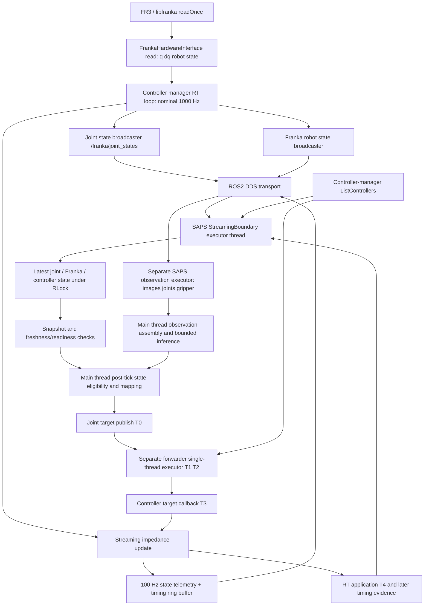

# FR3 feedback and readiness investigation — 2026-11-11

Investigation only: no robot motion, rollout, service startup, runtime correction,
threshold change, commit, or push. This is development diagnostic evidence, not a
formal manipulation result. Operator task observations below are annotations;
all four recorded software outcomes remain `failed` / `abort`.

## Findings

**The immediate causes are established; the origin of the feedback-delivery
pauses is not.** A, C and D fail a per-step fresh-feedback requirement bounded by
one 15 Hz interval. B fails the separate 100 ms arm-readiness freshness checks
during an outstanding Robotiq OPEN. All four show aligned delays in multiple
SAPS feedback streams. Controller telemetry generated inside each terminating
joint-feedback gap arrives afterward in a burst. Recorded controller periods
remain about 1 ms. This supports delayed non-real-time delivery/processing rather
than a stopped arm control loop, but cannot locate the delay at the publisher,
DDS, executor, interpreter or a lock without additional instrumentation.

No timeout increase is justified by these records. The terminating joint gaps
are 109–182 ms, exceeding **both** the 66.7 ms step budget and the 100 ms state
freshness limit. Merely dropping the post-tick callback requirement would not
make those old states acceptable.

## Preservation and actual Git states

At investigation start both working trees were clean:

| Repository | Branch | Actual HEAD | Comparison |
|---|---|---|---|
| SAPS | `experiment/physical-fr3-saps` | `575c842a7f653f0431bd0a7a457c817eba96f728` | Exact supplied baseline |
| ROS2 `src/franka_droid_stack` | `main` | `3dc23e39f5470ef929c5bfbb0f476b50d54fff03` | One commit after `e34c74c1c5f14d1fdc8a5e862437db5d93de4762`; README build instructions only |

Run-time provenance differs from today's SAPS checkout:
A used clean `f8b62482a35bc8d5ee328651ca132bef2555efff` on
`migrate/franka-robotiq`; B/C used `b2e951d6230d8b3d5b10a39fd0b346c48336bb53`
on the experiment branch, with recorded `.gitignore` changes (C also recorded
`docs/physical_zed_robotiq.md`). D used the clean supplied baseline. All four
recorded the actual ROS2 HEAD above. Comparing A's execution implementation to
the current one shows only the later `joint_state_wait_failure` instrumentation
in `policy_execution.py`; `streaming_ros.py` is unchanged. Therefore A lacks the
exact failing snapshot available for C/D; its deadline mechanism is comparable.

Original directories were inventoried and SHA-256 hashed **before analysis**.
Inventories include every file, byte size and relative path. Originals, images,
configurations and original outcomes were not edited. Final re-verification
confirmed all 534 files and complete directory file sets remained unchanged;
see `evidence_reverification.json`. Derived material is in
[`outputs/physical_feedback_diagnosis_20261111/`](../outputs/physical_feedback_diagnosis_20261111/),
separate from all four runs, and should not be committed as raw data.

| Run | Directory under `outputs/physical_c4/` | Files | Bytes | Applied policy actions / gripper commands / terminal holds | Saved main requests |
|---|---|---:|---:|---|---:|
| A | `c4_dev_long_20261111T083244Z` | 138 | 170425534 | 150 / 3 / 18 | 19 |
| B | `c4_dev_long_20261111T101530Z` | 84 | 118243854 | 80 / 5 / 10 | 10 |
| C | `c4_dev_long_20261111T101741Z` | 138 | 173078854 | 151 / 6 / 18 | 19 |
| D | `c4_dev_long_20261111T102518Z` | 174 | 224210400 | 200 / 6 / 24 | 25 |

D is in `outputs/physical_c4/`, not directly in `outputs/`.
Each inventory is named `<run>_inventory.json` in the derived directory.

The existing exporter produced wrist, exterior and side-by-side MP4s for all
four runs, in `video_083244/`, `video_101530/`, `video_101741/`, `video_102518/`.
Each has a complete `video_manifest.json`, source hashes and decoded frame-count
verification (209, 134, 243, 311 frames per stream, respectively, at 10 fps).
**These are sparse saved policy observations held on a timestamp grid, not
continuous footage.** They do not reveal every motion or exact failure instant.

## Comparative failure timeline

UTC is used for source stamps; add one hour for Oslo on this date. The exact
monotonic values below belong to the same recorded host, boot and time namespace
in all four runs; ROS epoch timestamps are never directly subtracted from them.

| Run | Operator annotation | Failure point | Terminating joint receive gap | Joint source-stamp endpoints (UTC) |
|---|---|---|---:|---|
| A | Marker placement succeeded | Replan 18, action 6 (zero-based), after action 5 | 138.662 ms | 08:33:15.139703 → 08:33:15.273719 |
| B | Repeated unsuccessful grasp attempts | Replan 9, gripper-transition readiness check | 109.024 ms | 10:15:55.432426 → 10:15:55.537365 |
| C | Successful grasp, retracting toward cup | Replan 18, action 7, after action 6 | 138.548 ms | 10:18:12.256161 → 10:18:12.390199 |
| D | Approaching cup, misaligned | Replan 24, terminal hold after action 7 | 181.813 ms | 10:26:00.054333 → 10:26:00.231345 |

| Run | Last joint callback before gap (monotonic ns) | First after gap | Failed tick eligible | Deadline | Failure observed |
|---|---:|---:|---:|---:|---:|
| A | 3875469695609 | 3875608357189 | 3875483062550 | 3875549729217 | Not recorded exactly |
| B | 10035762373307 | 10035871397609 | Not an action wait | 100 ms freshness | Snapshot ended 10035871171486 |
| C | 10172586087820 | 10172724635982 | 10172602001461 | 10172668668128 | 10172722834940 |
| D | 10640384440286 | 10640566253387 | 10640409476120 | 10640476142787 | 10640564217521 |

For C/D, the recorded latest source stamp had advanced beyond the previous
mapping reference, but its **receive time preceded eligibility**. There were
zero joint callbacks in the recorded eligible-to-failure interval. C checked
failure 120.833 ms after its tick, 54.167 ms after the deadline; D checked
154.741 ms after its tick, 88.075 ms after the deadline. A deadline is a
cooperative check, not a guarantee that Python wakes precisely at that instant.
These overshoots are consistent with scheduling/blocking delays, without
identifying which one.

The last applied policy target T0 → T4 was:

| Run | Last action index | Publish T0 (monotonic ns) | Applied T4 | Last inference request → response (monotonic ns) |
|---|---:|---:|---:|---|
| A | 5 | 3875419529164 | 3875420420841 | 3874919612594 → 3875034287647 |
| B | 7 | 10035123587403 | 10035124175915 | 10034463645351 → 10034592219724 |
| C | 6 | 10172539722567 | 10172540970874 | 10171974758101 → 10172094893171 |
| D | 7 | 10640346203926 | 10640347109059 | 10639742835830 → 10639860731269 |

Each last target has one forwarded record, accepted controller callback and
application record; its full T1/T2/T3 values are in `timing_summary.json`.
Inference completed before each failure; these were not policy response
timeouts. Last-request observation maximum source ages were 45.742, 46.652,
58.391 and 61.831 ms; cross-source skews were 45.173, 45.823, 57.503 and 61.054 ms.
All were within the configured observation limits (500 ms age, 250 ms skew).
No saved image or observation timing demonstrates camera activity caused a gap.

A's best-effort abort hold was applied. C's fresh abort-hold mapping was rejected
because Franka/controller evidence remained stale, so it was not published.
B retained its confirmed terminal hold and stopped the gripper. D's terminal
hold never published; the runner intentionally makes no second hold attempt in
that phase, so the last accepted policy target remains installed. This is
existing hold-last-target behavior, not evidence of deactivation.

## Measured timing and its limits

Computed from **all saved boundary callbacks**, including startup/drain, using
adjacent recorded receive timestamps and nearest-rank percentiles. These are
not uninterrupted publisher measurements or an action-only distribution.

| Run | Joint intervals N | Median | p95 | p99 | Maximum | ≥66.667 ms | >100 ms |
|---|---:|---:|---:|---:|---:|---:|---:|
| A | 30286 | 0.990 ms | 1.587 ms | 3.589 ms | 214.220 ms | 7 | 5 |
| B | 23808 | 0.990 ms | 1.606 ms | 3.347 ms | 164.663 ms | 4 | 3 |
| C | 30078 | 0.991 ms | 1.521 ms | 3.623 ms | 184.577 ms | 7 | 5 |
| D | 39417 | 0.994 ms | 1.494 ms | 4.513 ms | 241.519 ms | 9 | 6 |

Franka receive p99/max: A 3.453/213.896 ms; B 3.508/170.530 ms;
C 3.505/200.271 ms; D 3.912/246.524 ms. Controller-state receive p99/max:
A 24.940/213.883 ms; B 23.434/170.595 ms; C 25.894/200.347 ms;
D 24.701/246.553 ms. Joint source intervals have median about 1 ms but also
large gaps **between received samples**. Best-effort depth-limited subscriptions
can lose intermediate messages; source-stamp gaps here do not prove publication
stopped.

Across all applied targets (including holds), T0→T4 median/p99/max:

| Run | Targets | Median | p99 | Maximum |
|---|---:|---:|---:|---:|
| A | 188 | 0.904 ms | 1.410 ms | 1.421 ms |
| B | 100 | 0.948 ms | 1.459 ms | 1.460 ms |
| C | 188 | 0.957 ms | 1.505 ms | 1.517 ms |
| D | 249 | 0.963 ms | 1.480 ms | 2.282 ms |

Controller timing contains 33700/25780/33180/44520 period samples, respectively;
maximum 1.229740/1.222830/1.230924/1.227385 ms, none over 2 ms. These period
samples are not individually timestamped, so a particular cycle cannot be
located precisely inside a particular callback gap. They nevertheless contain
no 100 ms control-loop stoppage in the saved evidence. No inactive controller
telemetry, negative controller-manager readiness response or Franka health
violation was recorded in any run.

Stronger direct evidence of ongoing generation: controller telemetry carries
4/4/5/5 source timestamps strictly inside the terminating joint source gaps in
A/B/C/D. Those samples arrive after joint delivery resumes, in bursts spanning
roughly 0.4–5.1 ms after that joint callback. This establishes that at least
controller-state generation continued during part of each gap and that some
state delivery was delayed. It does not establish when each message entered
DDS or whether joint/Franka publishers skipped their own samples.

All extracted endpoints, source/receive distributions, top gaps, controller
samples, last observation and inference timings, application evidence and
Robotiq events are in `timing_summary.json`. Reproduce with:

```bash
python3 outputs/physical_feedback_diagnosis_20261111/analyze_timing.py
```

## Feedback path, executors and clocks



* `franka_hardware/src/franka_hardware_interface.cpp::read` calls `readOnce`,
  exposing q/dq and the full robot state; `robot_time` is the hardware duration
  counter. SAPS freshness does **not** use that hardware duration as epoch time.
* Local `controller_manager/src/ros2_control_node.cpp` triggers the RT loop on
  steady time; `controller_manager.cpp::update` invokes controller updates
  with `this->now()` (ROS clock), and a measured steady-time period. Therefore
  controller telemetry `[35]` and broadcaster headers are ROS epoch time,
  while RT timing evidence uses `CLOCK_MONOTONIC`. The two domains have
  separate purposes; the steady trigger does not make `[35]` a monotonic stamp.
* Joint-state broadcaster is the unique recorded `/franka/joint_states`
  publisher. Its package is installed; its C++ implementation was not present
  in the workspace source tree. Exact internal installed publisher locking
  was therefore not independently audited. Topic identity, stamps and received
  cadence are available; complete publication-call history is not.
* `franka_robot_state_broadcaster.cpp::update` stamps with the ROS update time,
  fills semantic robot state, uses a realtime publisher with bounded lock
  retries/sleeps, and signals a separate `publishRunner` thread for auxiliary
  topics. A mutex protects the shared message. Publisher thread contention is
  possible in this design, but not demonstrated as the cause here.
* `StreamingJointImpedanceController::update/publish_telemetry` uses a realtime
  buffer for targets, an RT timing ring, and a realtime publisher with trylock;
  telemetry attempts are limited to 100 Hz. A separate 20 ms wall timer drains
  timing samples. A failed telemetry trylock skips publication. Targets are
  latched, not cancelled when the last target's age passes 250 ms.
* `StreamingJointTargetForwarder` is a separate process using `rclpy.spin`
  with serialized callbacks: reliable/volatile keep-last depth 1 targets and
  telemetry, plus asynchronous `ListControllers` polling every 100 ms on a
  **steady** timer. It validates source timestamps with ROS now, active
  evidence expiry with monotonic dispatch time, and records T1/T2.
  It does not republish joint states or establish their publication cadence.
* `streaming_ros.py::StreamingBoundary` has a daemon thread repeatedly calling
  `rclpy.spin_once(..., timeout_sec=.01)`; all its subscriptions and 100 ms
  ROS-clock polling timer share that execution path. Joint, Franka and
  controller-state subscriptions use sensor-data QoS (best effort, keep-last
  depth 5); timing/forwarder evidence depth is 100. Its main-thread snapshots,
  publication checks, callbacks and evidence list share an `RLock`.
  `_joint` samples monotonic time at callback entry, validates names/positions,
  finite velocity and positive advancing ROS stamps, then replaces a single
  latest-state slot. It is not a FIFO of every measured state. Rejected joint
  messages set an error; no callback errors were retained at run end.
  `_franka` checks positive source stamps and health; `_state` records its
  callback receive time and raw 39-field data.
* `live_inference_hold_ros.py` transfers a separate `SingleThreadedExecutor`
  to another background thread for images, observation joints, Robotiq status
  and the 5 ms hand lifecycle timer. Observation subscriptions use depth 1
  best effort. Main-thread inference is synchronous and does not intentionally
  stop either observer, but threads still share the Python interpreter/GIL.
  Image conversion, evidence deep copies, allocation/GC, callback work and
  graph inspection under the boundary lock are candidate delays, not measured
  causes. No queue-age, GIL, lock-wait or GC-duration trace was saved.
* `franka_robotiq/robotiq_node.py` is a separate serial owner with a four-thread
  executor, serial `RLock`, separate service callback groups and 50 ms polling.
  Command waits release the serial lock between reads. The SAPS hand uses
  asynchronous services and monotonic lifecycle deadlines; its evidence copy
  has its own `RLock`. Serial waits are not intentionally on the boundary
  executor, but Python scheduling and other host resources may still interact.

No source evidence demonstrates a ROS/monotonic subtraction error in the
relevant freshness gates. Strict future rejection is implemented; B's values
specifically identify old data rather than future data. There is no historical
clock-step trace, so small clock adjustments cannot be ruled out globally.

## Exact readiness failure in B

`policy_execution.py::await_gripper_transition` checked readiness every roughly
10 ms while `check_inference()` reported a pending gripper transition. The
transition began at monotonic `10035235964021`, had a 3 s deadline, and failed
about **635.214 ms** later, after 49 completed checks. It did not exhaust the
3 s gripper transition timeout.

The failing snapshot spans `10035870719139`–`10035871171486` (0.452 ms).
The snapshot records measured-joint source/receive ages 108.558/108.798 ms.
The joint source had already advanced beyond the last action reference, but
was no longer fresh enough for the arm boundary.

For `franka_state_stale_or_future`, `_readiness` rejects either source or
receive age <0 or >100 ms. A Franka callback entered at `10035870339027`,
only 0.832 ms before snapshot end, **carrying source stamp
1794392155432433110**, still about 108.55 ms old. Receiving an old message just
before a check does not make its source stamp fresh.

For `controller_state_invalid_inactive_or_stale`, `_readiness` rejects:
width !=39, nonfinite data, `[38] != 1`, receive age outside [0,100 ms], or ROS
source age from `[35]` outside [0,100 ms]. B's last controller sample before the
snapshot had width 39, finite values, `[38]=1`, source time
1794392155.4255118 and receive time `10035755937068`. Its receive age was
**115.234 ms** and its source age approximately **115.472 ms**. Staleness is
sufficient to explain this flag; inactivity is not required.

The first newer joint callback follows snapshot end by 0.226 ms; the first
newer controller callback by 0.649 ms. Franka and controller evidence thus
fail together across a shared delivery pause, although the Franka receive
age itself was recent because one old message had just been processed.
Controller-manager active evidence was about 169 ms old from its successful
request dispatch, below its independent 300 ms limit; no manager inactivity
flag occurred. No saved sample reports deactivation or a Franka fault.
A very brief unsampled state change remains unobservable, but **there is no
positive evidence that the arm was actually inactive**.

The outstanding command was OPEN request 75, issued at monotonic
10034.859874498 s, about 1.011 s before the failing snapshot. It was cancelled
following the arm failure, with STOP requested at 10035.875198355 s and confirmed
at 10035.909084626 s. The response shows actual position 95, no fault, ready;
the cancelled OPEN has no successful completion result. There was no recorded
Robotiq lifecycle timeout causing this termination. Preserve the fail-closed
arm-readiness response even if it recovers milliseconds later.

## Deadlines and governing rules

All intervals below are independent; a long observation wait does not override
the shorter action-step budget. Values come from run records or the unchanged
implementation/configuration as indicated.

| Source / function | Value | Clock and trigger | Relation to 15 Hz / consequence |
|---|---|---|---|
| `streaming_playback.py::deadlines`, `policy_execution.py::send` | `PERIOD_NS=66,666,667`; absolute ticks individually rounded from k/15 | Monotonic; wait requires callback receive ≥ eligible tick AND source stamp > previous row reference; abort when scheduled+period or eligible+observation timeout reached | One new eligible callback per action and terminal hold; failure `no_new_measured_q_for_step`; no remaining actions |
| `send`, `StreamingBoundary.publish` | Same period | Monotonic; preparation/publication lateness ≥ period | Reject missed full interval even if a state arrives after deadline; no catch-up burst |
| `single_action.py::safety_gate`, `StreamingBoundary._readiness/publish` | 100 ms `STATE_AGE` | ROS now−source and monotonic now−receive, independently in [0,100 ms] | 1.5 periods; reject stale/future reference or Franka state, including abort holds |
| `StreamingBoundary._readiness` controller telemetry | 100 ms receive and source, width 39, finite, `[38]=1` | Monotonic receive age; ROS source age from `[35]` | 1.5 periods; combined invalid/inactive/stale readiness flag |
| `StreamingBoundary._poll/_readiness` | 100 ms polling; 300 ms evidence expiry | Timer ROS clock; expiry monotonic since successful request **dispatch**, not response | About 1.5/4.5 periods; missing/expired active evidence fails closed; one pending request at a time |
| `single_action.py::safety_gate`, boundary `publish` | 1 s `ACTION_AGE` | Monotonic since chunk origin | 15 periods; reject old policy playback action; not these observed failures |
| `run_policy_episode::send`, `prepare_live_request`, startup waits | 30 s in all run records | Monotonic; no eligible state/observation before bound | 450 periods; step wait still stops after one period; pre/abort holds can use this longer acquisition bound |
| `run_policy_episode::confirm`, `wait_for_application` | 2 s in all run records | Monotonic; no accepted unique T4 delivery proof by deadline | 30 periods; hold confirmation fails; unrelated to 66.7 ms state acquisition |
| `run_policy_episode::reacquire_readiness` | Application bound, 2 s | Monotonic; no empty readiness reasons by deadline | Command-free wait with installed terminal hold; no next inference/action on failure |
| `await_gripper_transition` | 3 s function default; B explicitly records 3 s deadline | Monotonic; pending replacement/completion; snapshot readiness failure raises immediately | 45 periods; no next observation/replan; confirmed terminal hold retained |
| `RobotiqHand::_tick/_send_stop` | CLI default 3 s; not separately persisted as a scalar in `run.json` | Monotonic service lifecycle deadline | Outstanding command/stop failure latches error; no evidence this fired here |
| `live_inference_hold.py::POST_HOLD_DRAIN_SECONDS`, episode post-hold barrier | 2 s | Monotonic; require valid delivery/health and all four evidence streams after T4 | 30 periods; `post_hold_evidence_timeout`; also fixed failure drain sleep |
| `live_shadow.py::prepare_live_request/infer_live_request` | 500 ms source age, 250 ms cross-source skew | ROS source/assembly times; receive ages separately logged | Observation limits differ from arm control limits; rejected pair reacquired within 30 s |
| `policies/bounded_websocket.py::__init__/_receive` | 120 s open/receive in run records; close 1 s | Delegated websocket timeout API; SAPS call timing monotonic | 1800 periods; fail transport, no replan retry. This is not an end-to-end inference CPU deadline; exact library internals were not audited |
| Forwarder `on_target`, controller `target_callback` | Max age 250 ms; future tolerance 50 ms | ROS now−target source stamp | 3.75 periods / .75 period; reject incoming stale/future command; accepted target continues to be held |
| Forwarder `poll/on_controllers/on_target` | Poll 100 ms; evidence expiry 300 ms | Steady timer; monotonic dispatch age | Fail closed on unconfirmed/expired controller availability; not observed rejecting these final delivered targets |

The post-tick condition is stronger than merely using a fresh measured state:

`receive_monotonic >= tick && source_stamp > previous_reference_stamp`.

At a nominal 1 kHz state rate it normally succeeds quickly, but a Python/DDS
path with observed 100+ ms tail delays cannot guarantee it every 66.7 ms. The
mean observation-collector joint rates (551–655 Hz approximately; exact rates
in JSON) are not a deadline guarantee, and are from a different subscription.
Normal latency, stale feedback, unavailable controller and safety faults must
remain separate outcomes.

## System evidence and confidence ranking

Relevant controller logs for PIDs 23018 (A), 84065 (B/C), 88433 (D), associated
launch logs and available forwarder/configuration logs were inspected. Source
paths and hashes are in `system_log_inventory.json` and
`launch_log_inventory.json`; warning/error extracts are in `launch_findings.json`.
Logs confirm 1000 Hz controller-manager operation, FIFO priority 98 successfully
set, and overrun logging disabled. There is no controller/driver failure entry
within ±1 s of any terminating source gap. Absence of overrun warnings alone is
not useful given that disabled setting; period samples are stronger evidence.

Launch logs contain unrelated startup failures of the unused native Franka
gripper process and later manual shutdown entries; these predate/follow the
terminations, and do not establish an arm or Robotiq crash at a failure.
Kernel journal for 08:25–10:28 UTC contains no event within ±1 s of these gaps.
There are later USB/ZED reset/transfer errors around 10:26:38 UTC, about 38 s
after D's gap, not simultaneous evidence of its cause. `dmesg --ctime` was denied;
`journalctl -k` succeeded. Ten-minute sysstat samples show roughly 96–98% aggregate
CPU idle, about 8–12% memory used and negligible I/O wait. Such coarse averages
cannot rule out one-core starvation, short pauses or thread scheduling delays.
No per-thread scheduler, GC, lock, queue-age or inference-process load trace was
available. Video exports were performed offline during this investigation;
they could not cause the historical failures. No continuous video recorder
activity is established by the saved rollout records.

| Rank | Finding / hypothesis | Confidence and limit |
|---|---|---|
| 1 | Fresh-feedback eligibility deadline caused A/C/D; stale state evidence caused B | High: code and recorded gaps/flags agree; A lacks exact failure snapshot |
| 2 | A shared non-RT feedback-delivery/processing pause plausibly explains all four | Moderate-to-high: aligned streams, bursts of telemetry generated during gaps, uninterrupted recorded RT periods; identical underlying mechanism not proven |
| 3 | SAPS executor scheduling, GIL/GC, allocation/deepcopy, graph/lock contention, or DDS dispatch starvation | Plausible, unranked within this group: no direct profiler/lock/transport trace. Deadline overshoots support main-thread delay too |
| 4 | Broadcaster/realtime-publisher contention or skipped state publication | Possible for joint/Franka streams; no publication counters; controller generation continued during parts of the gaps |
| 5 | Actual controller unavailability, robot fault, wrong timestamp domain or slow target application | Low support: all saved active flags/health/polls normal, T0→T4 small, timestamp domains consistent. Brief unsampled changes and clock steps cannot be excluded |
| 6 | Policy inference or Robotiq motion directly caused the pauses | Unestablished: last inference already returned; B has outstanding OPEN, C a recently completed CLOSE, D last CLOSE completed about 10 s earlier. Temporal proximity is not causation |

A and C both fail during policy actions and D during a terminal hold; B uses a
different readiness gate during gripper waiting. Thus they plausibly share a
latency mechanism, while their **proximate failure rules and recovery behavior
differ**. These records do not demonstrate a specific ROS2 source defect that
should be corrected now.

## Minimal next step and proposed supervised diagnostic procedure

Recommend instrumentation first, preserving every existing gate and deadline:

1. Record bounded, low-allocation callback entry/exit traces with ROS source
   stamp, monotonic entry/update/exit, accepted/rejected reason and sequence.
   Preserve rejected messages too. On failure save one atomic snapshot of all
   three state stamps, receives, raw controller validity/active flag, poll
   request/response, tick and deadline. Avoid graph calls or file I/O while
   holding the boundary state lock. Measure lock acquisition/hold times before
   changing lock behavior.
2. Add monotonic heartbeat/iteration timings to both SAPS executors and main
   tick loop, plus GC start/stop timestamps and durations of image conversion,
   evidence copies, gripper checks and graph calls. Use bounded buffers flushed
   after termination, not synchronous per-message logging. Measure overhead.
3. Run an independent low-overhead C++ receive probe on joint, Franka and
   controller-state topics, recording source/receive/sequence and DDS message
   metadata if supported. A second Python thread in the same process cannot
   independently rule out GIL stalls. If both readers see gaps, add publisher
   attempt/success/drop counters or ROS tracing outside the RT critical path.
4. Capture per-thread scheduler wakeups/context switches and CPU usage for SAPS,
   DDS and publisher workers, together with CPU affinity, policies and clock
   synchronization changes. Retain existing controller T0–T4 and RT evidence.
   Do not change process priorities, QoS or timeout values during diagnosis.
5. First validate the trace on fake input/non-actuating tests. Then, only with
   operator supervision and a new unique diagnostic run ID, perform a stationary
   read-only observation test at the existing camera rates; add bounded policy
   inference while stationary as a separate phase. Compare traces under these
   conditions before proposing any commanded movement or gripper actuation.
   A physical rollout is a separate supervised decision and was not run here.
6. If motion is subsequently approved, keep current limits, workspace,
   collision/safety supervision, calibration and action semantics. Stop on the
   existing first failure, preserve traces without retrying actions, and stop
   any policy server started solely for that diagnostic session afterward.

Interpretation: independent probe fresh + SAPS stale localizes toward SAPS;
both readers stale + publisher generation fresh localizes toward publication or
transport; publisher counter/time gap localizes upstream. A long GC/lock or
scheduling interval aligned to both the callback gap and missed wakeup is needed
before assigning that cause. Repeated read-only success alone does not qualify
physical experiments.

If instrumentation demonstrates only an overly strict post-tick synchronization
requirement while all ages remain safely fresh, a future alternative is to map
from the newest **advancing, validated measured state**, bounded independently
by source and receive age, with explicit command-sequence/T4 confirmation and
separate scheduling deadlines. Do not extrapolate state, reuse an old action,
execute catch-up bursts or silently permit stale evidence. Such a change alters
which measured state anchors a target and potentially trajectories; it requires
an explicit protocol decision and new validation. It is not implemented or
recommended as the immediate fix for these >100 ms gaps.

Potential future modification sites: `streaming_ros.py` (atomic failure state,
callback/lock traces), `live_inference_hold_ros.py` (observer traces),
`policy_execution.py` (tick/wait traces), and optional diagnostics under `tools/`.
Only if independent probes demonstrate an upstream defect should the identified
ROS2 broadcaster/forwarder/controller source be changed. No policy preprocessing,
gripper calibration, gains, workspace limits or outcome schema change is needed
for the proposed observation instrumentation. Prefer a separate versioned trace
artifact so existing rollout schemas and experimental comparability remain
explicit.

## Validation and files changed

Added six deterministic non-actuating tests in
[`test_physical_feedback_readiness.py`](../tests/unit/test_physical_feedback_readiness.py):
normal feedback and exact 100 ms boundary; shared delayed callbacks with active
controller; recent callback carrying old source stamp (B); future ROS stamps;
inactive/missing controller state; recovery of snapshot freshness. They call the
actual `_readiness` implementation with mocked ROS graph interfaces, no ROS
runtime, network or hardware. Recovery of a snapshot does not resume an aborted
episode.

Existing `test_physical_policy_execution.py` additionally covers frozen receives,
nonadvancing stamps, period-limited waits despite a long observation timeout,
application-confirmation timeout, gripper transition readiness loss, pending
replacement timeout and readiness reacquisition failure. Existing playback
coverage checks stale references, no catch-up burst and no unsafe hold publish.
For any future synchronization correction, retain these and add simulated
sub-period delayed-but-fresh feedback, >100 ms outage, and callbacks arriving
just before/after each independent deadline.

Commands/results:

* Focused readiness discovery with `PYTHONPATH=src .venv-physical/bin/python -m
  unittest discover -s tests/unit -p test_physical_feedback_readiness.py -v`:
  six passed.
* Initial `make check`: sandbox Docker socket permission denied; retried with
  authorized execution using the existing images. Baseline: 492 tests, one
  skipped, passed; compile passed.
* First test-added Docker check exposed Python 3.8 eager `list[str]` annotation
  evaluation; corrected the new test with `from __future__ import annotations`.
  No runtime source changed. Final `make check`: **498 tests, one skipped, passed; compilation passed**.
  The skipped test required Git, unavailable inside that image; host verification
  of that module passed all five tests (see `host_git_provenance.log`).
* Existing video exporter completed all four exports and decoded every output
  stream to verify counts. No hardware smoke test or physical rollout executed.

Only the investigation document and focused regression-test file are source-tree
additions. Offline extraction script, timing JSON, inventories, test receipts,
system extracts and MP4s are ignored derived diagnostic artifacts. Runtime code,
configuration, equations, seeds, output records, third-party sources and ROS2
sources remain unchanged. The remaining uncertainty is the location and cause
of the delivery pauses; experiments are not newly qualified by this report.
