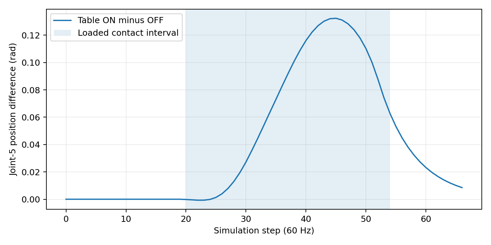
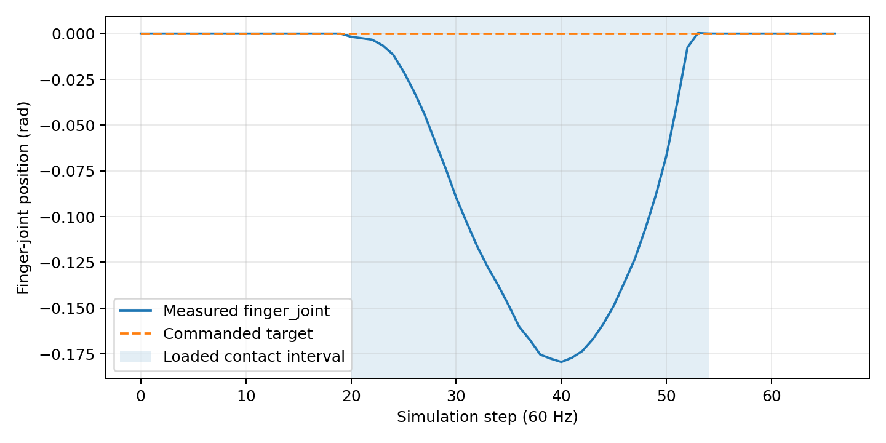
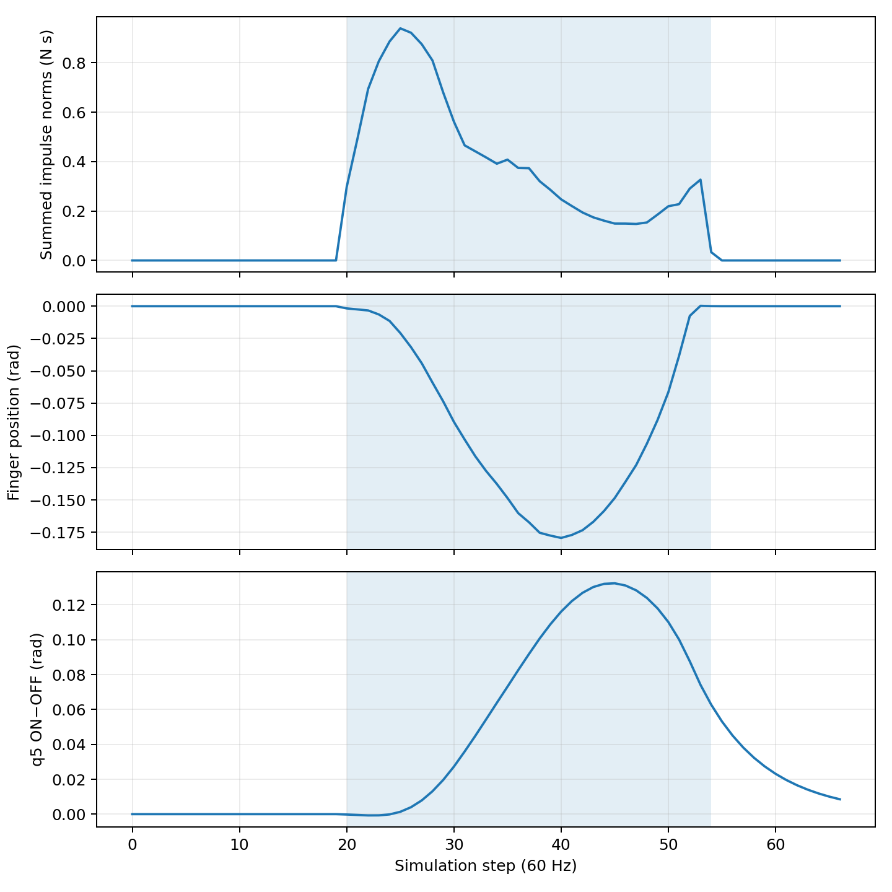
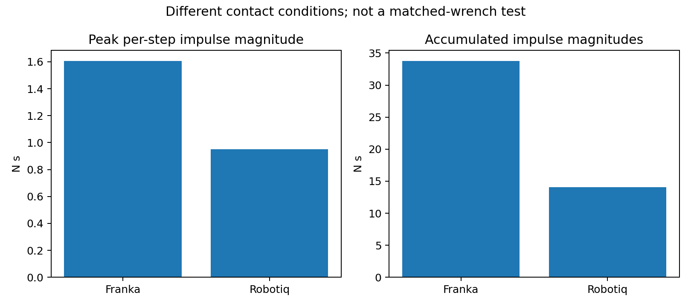

# SIM-P13G-HG1 q5 investigation

**Status (2026-10-13): H1/B1 and the Fusion-v13 mounting correction/contact
comparison are complete; H3 remains open.** The large Robotiq q5 response to
loaded fingertip/table contact was the original known anomaly, not a finding
newly discovered by these studies. The remaining question is whether it
reflects an error in our model conversion/configuration, a simulation/contact
artifact, or mechanically plausible behavior of the correctly represented
end-effector. The Robotiq source CAD came from the manufacturer; this does
not independently validate its converted USD articulation or physical dynamics.

The investigations test three distinct explanations: **H1**, whether the same
prescribed contact-free link-8 impulse reproduces the large response; **H2**,
whether incorrect mounting geometry or CAD-to-USD transforms explain it; and
**H3**, whether the remaining assembly/contact response arises from the
implementation, simulated dynamics/constraints, or a physically plausible
mechanism. H1 is bounded to its specific impulse protocol and H2 is bounded
to the verified mounting correction; neither resolves H3.

## Historical loaded-contact result

SIM-P13F table ON/OFF pairs used identical 66-step commands within each
assembly (36 approach, 30 retreat, 1/60 s per step), with a measured initial
pad clearance of 5–6 mm and pre-contact downward speed near 0.0195 m/s.
Both table-enabled runs established nonzero loaded fingertip/table contact;
both controls disabled table collision. The [Stage A analysis](../../outputs/isaac_joint5_diagnostics/sim_p13g/stage_a_report.md)
found a peak ON-minus-OFF q5 position shift of **+0.130094 rad at step 45**
for Robotiq, versus **−0.002350 rad at step 38** for Franka. The Robotiq
loaded-contact interval was steps 20–53; its final q5 shift at step 66 was
+0.008270 rad. Its first recorded loaded pad was the left fingertip collision
mesh against `/World/Table`. This comparison did not match contact point or
full load history across assemblies; it cannot isolate articulation dynamics.

The four SIM-P13F archives under
`outputs/isaac_joint5_diagnostics/matched_contact_comparison/` remain
unchanged. Historical q5 evidence belongs to the older mounting geometry.
Logged dq disagrees with position finite differences and is not used as the
primary response measure here.

## B1 common-wrench result

The [B1 closeout](sim_p13g_b1_common_wrench.md) applied one prescribed
contact-free link-8 impulse at the same rigidly defined point to each
assembly, with a no-pulse control. The peak q5 pulse-minus-control position
response was **+1.07125e-5 rad** for Franka and **+1.66281e-5 rad** for
Robotiq, both at step 10; the between-assembly contrast was
**+5.91563e-6 rad**. These small responses do not reproduce the earlier
+0.130094 rad loaded-contact result. Delivered impulse was not independently
measured, direct sleep was measured in the qualified controls at step 25, and
the q/dq inconsistency persists in both assemblies. The common-wrench test
cannot isolate the tabletop contact geometry or mount effect.

## CAD revision and selectable simulation geometry

Fusion `FR3_2F85_ZED` version 13 moved the coupling and fixed gripper base
3 mm toward the unchanged physical flange, without a meaningful rotation
change. Selected supporting mating planes are at 0 and +11 mm in the flange
frame; their trimmed-face containment remains unresolved. The gripper-base
CAD origin changed from +13.758 to +10.758 mm. The imported USD-base
registration uses the upstream base visual-frame convention and remains
conditional. The camera pose is unchanged. See the
[CAD audit](../../outputs/isaac_joint5_diagnostics/sim_p13g/hg1_geometry_audit/revised_20261013_102402/report.md)
and [candidate transform record](../assets/FR3_2F85_ZED_transforms/fusion_v13_candidate.json).

The explicit historical scene
`sim/configs/fr3_droid_robotiq_historical_hg1_scene.json` selects a
byte-for-byte copy of the committed assembly, SHA-256
`e7330029d99b44502337c3822efeeb6bd6ec0f19f8279286e287d4303a849ad1`.
The candidate scene
`sim/configs/fr3_droid_robotiq_fusion_v13_candidate_scene.json` selects an
overlay that changes the Robotiq parent translation and the fixed-joint
body0 local anchor to +0.010758 m. The body1 anchor, rotations, arm/gripper
joints, drives, collision shapes, mass, and inertia are not reauthored. The
operator's separate 3 mm coupling-visual translation is retained only in the
candidate overlay; the referenced coupling asset has no authored physics
properties. This visual adjustment has no verified CAD mesh registration.

Standalone OpenUSD confirms the candidate base pose at +0.010758 m and the
grip-frame pose at +0.144475067608 m in flange coordinates, anchor
coincidence, ten unchanged internal gripper joints, and both active pad
collision meshes. The candidate scene JSON differs from the historical
scene only by selected asset. The static result is
`outputs/isaac_joint5_diagnostics/sim_p13g/hg1_b2_static/validation_v2.json`.
The subsequent local Isaac 6.1 no-step composition check exited successfully
with `stock_fr3_arm_composed_and_compared: true`, ten compared finger joints,
two compared fingertip collision meshes, and `wrist_camera_config_equal: true`.
The candidate collider inspection also found both enabled fingertip meshes
using `convexHull` approximation, with no discovery or correspondence error.
The camera is created from the unchanged scene configuration at runtime, not
authored in this assembly USD. These checks establish composition consistency,
not complete CAD validation of internal finger pivots or pad geometry.

## Fusion-v13 candidate loaded-contact comparison (completed)

The locally executed candidate table-ON run used
`sim/configs/fr3_droid_robotiq_fusion_v13_candidate_scene.json`, the qualified
fingertip collider report, and the established SIM-P13F calibration and
contact gates. The table-OFF run replayed its saved 66-step plan with the same
candidate scene and no loaded pad/table contacts; retreat completed. The
scene-selector change is preserved as
`patches/hg1_b2_contact_runner_scene_selector.patch`, since the runnable
SIM-P13F diagnostic remains under Git-ignored `outputs/`.

The archived historical and candidate ON/OFF pairs were compared using
`tools/analysis/hg1_compare_q5_contact.py`. Source result:
`outputs/isaac_joint5_diagnostics/hg1_b2_candidate/comparison.json`.

| Measurement | Historical Robotiq | Fusion-v13 candidate |
| --- | ---: | ---: |
| Initial clearance | 5.7442 mm | 5.6828 mm |
| Pre-contact normal speed | 0.0196999 m/s | 0.0196924 m/s |
| First / last loaded contact step | 20 / 53 | 20 / 54 |
| Loaded contact steps | 34 | 35 |
| Contacting bodies | left fingertip / table | left fingertip / table |
| Minimum recorded separation | −0.4011 mm | −0.4023 mm |
| **Peak q5 ON-minus-OFF** | **+0.1300943 rad @ 45** | **+0.1323665 rad @ 45** |
| Final q5 ON-minus-OFF | +0.0082698 rad | +0.0085302 rad |

The candidate peak exceeds the historical peak by **+0.00227219 rad**
(approximately **1.75%**); it does not diminish or remove the irregular q5
response. Other arm joints retain a similar ON-minus-OFF peak pattern in the
archived seven-joint comparison. The contact conditions are closely similar
by the recorded onset, contacting body, speed, and separation, but the
candidate has one additional loaded-contact step. These are single pairs,
not a repeatability or statistical-equivalence study; an equal onset does not
prove identical force histories.

**H2 finding:** the 3 mm mounting correction and resulting CAD-to-USD base
and grip-frame transforms were verified under the documented visual-frame
registration assumption. The specific original mounting-translation error
is **not sufficient to explain the q5 anomaly**. This does not validate the
manufacturer's internal finger pivots against the composed USD: Fusion's
finger joint axes/origins were not provided, the face exporter retained
`plane_qualified_trim_containment_unresolved`, and the CAD pad labels were
not independently mapped to the USD left/right bodies.

## Open H3 — interpretation and next gate

The existing Franka and Robotiq contact experiments establish the known,
strong assembly-associated difference, but their calibrated trajectories and
contact load histories are not identical. The contact-free B1 impulse does
not reproduce the anomaly, and the Fusion-v13 remount does not remove it.
Neither result distinguishes an implementation/configuration defect from a
simulation contact/constraint artifact or physically plausible behavior.

The Robotiq design was obtained from the manufacturer and must remain in the
DROID-style setup. We should **not redesign or substitute the gripper** as a
response to this anomaly. Manufacturer CAD provenance does not in itself
verify the USD's collision approximations, joint attachments, inertial
properties, drives, or physically realistic contact response. The repeated
`fr3_link8` PhysX inertia-fallback warning and the unqualified q/dq stream
remain limitations, not demonstrated explanations.

**Next gate:** compare available manufacturer/source physical and joint
definitions with the composed Isaac implementation, including effective
contact and joint constraints; then select one narrowly specified diagnostic
that can discriminate a conversion/configuration fault from behavior of the
simulated articulation. Preserve all existing scenes, control plans, outputs,
and operating conditions. Do not interpret the existing q5 data as proof of
real-world Robotiq behavior, or launch an unapproved parameter sweep.

## Local evidence and reproducibility

- Historical ON/OFF: `outputs/isaac_joint5_diagnostics/matched_contact_comparison/robotiq_table_multijoint/` and `robotiq_no_table_multijoint/`.
- Candidate ON/OFF: `outputs/isaac_joint5_diagnostics/hg1_b2_candidate/robotiq_table/` and `robotiq_no_table/` (the latter was renamed from the runner's `robotiq_table_off` output).
- Position comparison: `outputs/isaac_joint5_diagnostics/hg1_b2_candidate/comparison.json`.
- Composed-stage check: `sim/scripts/hg1_composed_stage_check.py`; runtime result was supplied in the local terminal output.
- CAD source hashes and earlier revision caveats: `sim/cad_reference/fr3_robotiq_zed/provenance.md`.
- Candidate static validation: `outputs/isaac_joint5_diagnostics/sim_p13g/hg1_b2_static/validation_v2.json`.

All paths under `outputs/` are local Git-ignored evidence and **are not
preserved by this commit**. The historical and candidate scene selectors
and USD references must remain separately recoverable. The collider
inspection's startup log was written under the diagnostic runner's
`matched_contact_comparison/startup_logs/` and was manually moved for the
candidate runs; this location issue did not affect the reported contact
comparison. The stored files should be backed up with checksums.

## H3 preliminary contact-dynamics evidence

The following observations use the archived Fusion-v13 Robotiq table-ON
and table-OFF runs. They are preliminary H3 evidence, not an explanation
of the underlying contact dynamics.

### Joint-5 response

The table-ON minus table-OFF q5 position difference begins near the
first loaded fingertip/table contact at step 20. It grows smoothly,
reaches +0.1323665 rad at step 45, and decreases during retreat.
Loaded contact is recorded through step 54. The remaining q5 difference
at step 66 is +0.0085302 rad.

The smooth trajectory is consistent with a sustained contact response
and does not, by itself, indicate numerical instability. Its magnitude
and physical realism remain unverified.

### Driven finger-joint response

The Robotiq `finger_joint` target remains 0 rad throughout the run.
During loaded contact, its measured position reaches -0.1794561 rad
(approximately -10.28 degrees). It subsequently returns close to zero.

The measured finger movement and q5 displacement are temporally
associated, but the available measurements do not establish a unique
causal transmission mechanism.

### Runtime joint-limit inspection

A separate read-only Isaac Sim 6.1 preflight of the Fusion-v13
candidate confirmed:

- The selected driven DOF is `finger_joint`, index 7.
- The composed USD specifies a revolute Z-axis joint with limits
  0 to 47 degrees.
- The articulation interface reports limits [0, 0.82030475] rad.
- The settled initial position and position target are approximately
  zero and exactly zero, respectively.

The archived contact run nevertheless reports positions below the
reported lower limit, reaching -0.1794561 rad. This is a substantive
state-versus-limit discrepancy. Its cause and the actual runtime
constraint-enforcement behavior have not yet been established.

### Franka versus Robotiq contact loading

In the earlier SIM-P13F contact comparison, the Franka hand recorded
27 loaded fingertip/table steps and the historical Robotiq recorded 34.

The Franka hand's peak per-step summed contact-impulse norm was
1.60631 N s, compared with 0.95224 N s for Robotiq. The sums over
loaded steps were 33.76293 N s and 14.03370 N s, respectively.
Nevertheless, the respective absolute peak q5 ON-minus-OFF position
differences were approximately 0.002350 rad and 0.130094 rad.

These quantities are sums of recorded impulse magnitudes, not signed
net impulses, resolved contact wrenches, or joint-5 disturbance torques.
The two end-effectors have different geometry, articulations, dynamics,
contact locations, and loading histories. Consequently, these values
do not constitute a force-matched compliance comparison. They do
weaken a simple explanation based only on larger total contact-impulse
magnitude in the Robotiq case.

### Evidence preservation and limitations

The four figures are generated by
`tools/analysis/h3_plot_contact_evidence.py` from archived JSON
under `outputs/isaac_joint5_diagnostics/`.

A local evidence archive was created on 2026-10-13:

- Archive: `outputs/isaac_joint5_diagnostics/h3_preservation/h3_evidence_20261013T121219Z.tar.gz`
- Manifest: `outputs/isaac_joint5_diagnostics/h3_preservation/h3_manifest_20261013T121219Z.json`
- Archived files: 90
- Archive SHA-256:
  `98b244c8d5db28b6f6aa1b46399f1c94bb7b437f75bef14b00c4bb108fe3ba95`

The archive and raw contact results remain Git-ignored local evidence;
this documentation commit does not provide an independent remote
backup of those records.

The archived explicit-actuation-effort fields are zero, but this does
not establish zero internal drive or constraint forces. The precise
semantics of the projected-joint-force channel also remain to be
qualified. Previously identified q/dq inconsistencies remain
unresolved.

**H3 remains open.** The next validation should replay the preserved
Fusion-v13 contact plan with additional logging of all gripper DOFs,
their reported limits, and relevant constraints. The qualified
baseline runner and original outputs must remain unchanged.

## H3 exploratory investigation closeout

**Status: exploratory investigation complete; physical fidelity unresolved.**

The H3 investigation used the Fusion-v13 candidate FR3–Robotiq
assembly, preserving the original gripper mechanics and nominal
32-position-iteration articulation setting except in the explicitly
identified solver ablation.

### Completed diagnostic evidence

| Test | Result |
| --- | --- |
| H3-C1: archived-plan replay | The 67-sample q5 ON-minus-OFF trajectory reproduced exactly; peak +0.1323665 rad at step 45. |
| H3-C2: joint constraints | The driven finger reached -0.1794561 rad against a reported zero lower limit. Nominal mimic residuals reached 0.213999 rad under contact, while remaining close to zero without table contact. |
| H3-D1: solver ablation | Increasing articulation position iterations from 32 to 64 increased peak q5 displacement from 0.132367 to 0.184897 rad. Summed contact-impulse magnitudes increased from 14.316 to 25.552 N s, and first contact shifted from step 20 to 22. The constraint deviations persisted. |
| H3-D2: fingertip impulse | A dispatched 0.166667 N s upward impulse at the left fingertip produced a peak absolute q5 pulse-minus-control difference of 3.372e-5 rad, without reproducing the large finger-limit or mimic residuals. |
| H3-D3: sustained force | A 10 N upward force was dispatched for steps 20–53 at a point derived from the left fingertip collision mesh. Both runs completed; peak absolute q5 force-minus-control difference was approximately 0.0002532 rad. The large tabletop constraint deviations were not reproduced. |

The first H3-D3 attempt stopped before the experiment could
complete because its archived world-frame application point failed
a geometric qualification check. The completed revision used a
fingertip-mesh-derived point instead. Its load-record JSON files
contain literal trailing backslash-n characters, which the original
execution archive preserves. Analysis must account for this formatting
defect without changing the archived source files.

### Interpretation

The tabletop q5 response and gripper constraint deviations are
reproducible features of this simulated contact scenario. The
contact-free impulse and sustained-force protocols did not recreate
them, but neither protocol reproduced the tabletop contact's spatial
force distribution, resolved wrench history, or rigid-surface
constraints.

The solver ablation demonstrates sensitivity to numerical settings,
but it also changed contact timing and accumulated impulse
magnitudes substantially. It therefore cannot isolate the causal
contribution of the mimic constraints or joint-limit excursions.

The recorded nominal mimic residuals and driven-finger lower-limit
excursion remain unexplained. The available results neither
demonstrate an incorrect PhysX implementation nor validate the
physical accuracy of the converted Robotiq mechanism. Successful
force API dispatch was not an independent measurement of delivered
force or impulse.

### Decision and scope

Exploratory H3 testing is closed without modifying gripper
parameters, collision geometry, inertia, arm drives, or solver
settings. The original 32-iteration configuration remains the
reference. The candidate simulation is not qualified for claims
requiring physically accurate fingertip contact forces, gripper
constraint enforcement, or contact-induced arm compliance.

The simulation may continue to support separately qualified
software-level and policy-interface experiments. Any subsequent
research claim depending on physical contact fidelity requires an
independently justified validation or model correction.

The H3-C1 through H3-D3 raw outputs, logs, diagnostic runners, and
checksummed evidence manifest are preserved locally under
`outputs/isaac_joint5_diagnostics/`. The earlier H3 evidence
archive and this final evidence archive are not included in Git.
